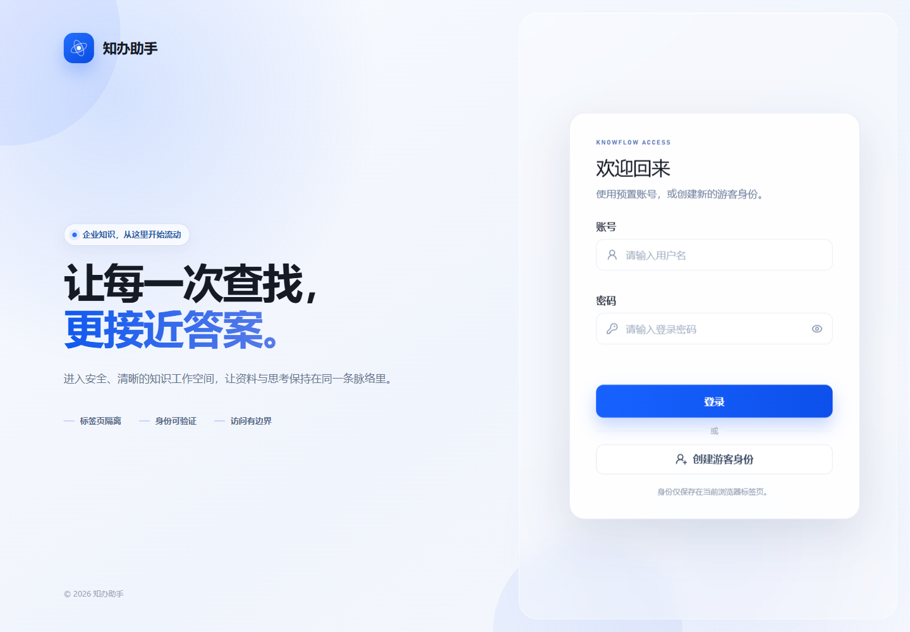
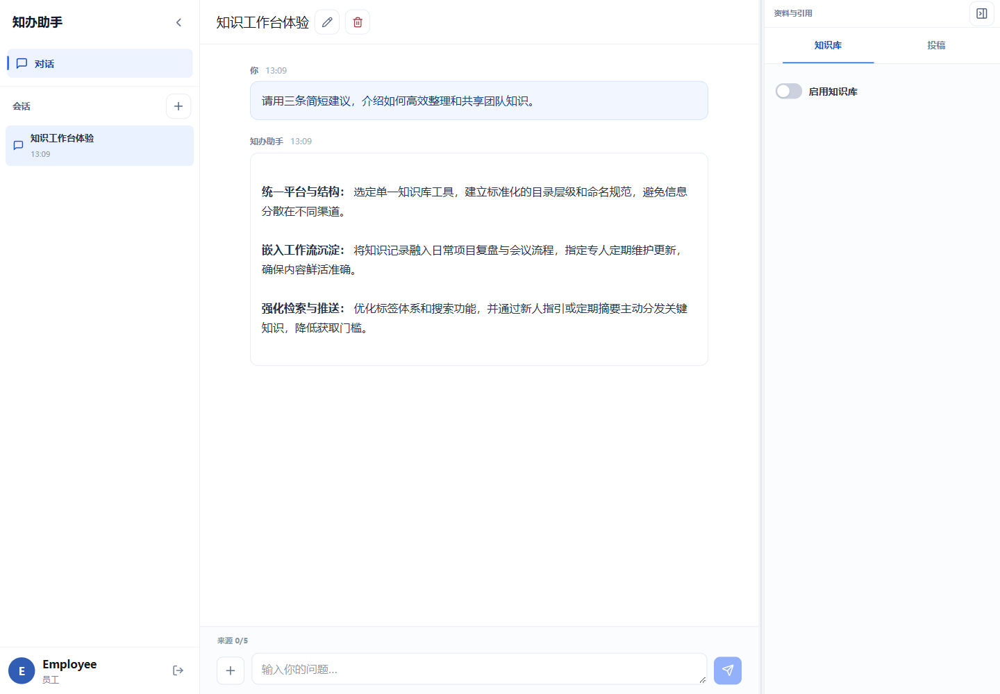
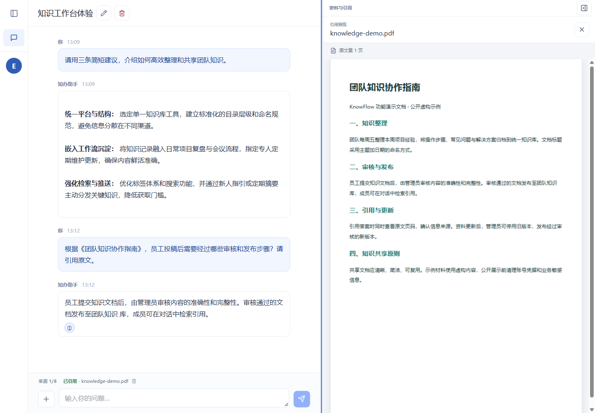
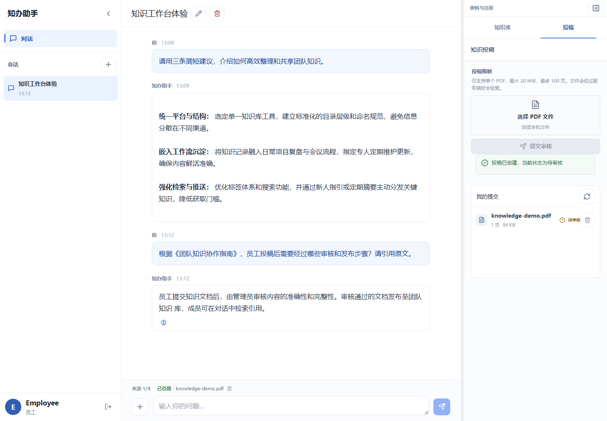
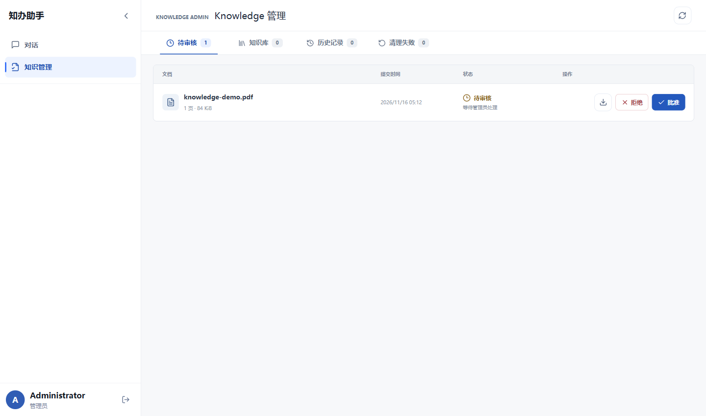

# KnowFlow

KnowFlow 是一个中文知识工作台，支持员工、管理员和游客登录、连续对话、会话 PDF 附件问答、页级引用预览、知识投稿与审核发布、知识范围控制，以及资源删除和清理重试。

前端使用 React、TypeScript 和 Vite，后端使用 FastAPI、SQLAlchemy 和 Docling。MySQL 保存业务状态，MinIO 保存私有 PDF，Elasticsearch 保存检索片段，Chat、Embedding 和 Rerank 通过模型服务接口提供。

## 功能展示

以下图片截自实际运行页面。问答与投稿使用公开虚构的《团队知识协作指南》演示文档。

### 登录与身份切换

支持员工、管理员账号登录，也可创建游客身份。登录状态按浏览器标签页隔离。



### 会话与连续对话

在工作台创建、重命名和切换会话，保留上下文开展连续问答。右侧资料栏提供知识库与投稿入口。



### PDF 问答与页级引用

上传 PDF 后围绕文档提问，回答附带引用入口。点击引用可在右侧查看对应原文页，并调整资料栏宽度核对答案。



### 员工知识投稿

员工上传 PDF 提交审核，在“我的提交”中跟踪投稿状态。



### 管理员审核与知识管理

管理员集中查看待审核投稿，下载文档并批准或拒绝。管理界面还提供知识库、历史记录和清理失败视图。



## 环境要求

- Python 3.12 和 uv。
- Node.js 24 和 npm 11。
- MySQL 8.4。仓库提供 Docker Compose 配置，可使用 Docker Engine 与 Compose 插件启动。
- 可直接访问的 MinIO S3 API 和 Elasticsearch 服务。当前 Compose 提供 MySQL，MinIO 与 Elasticsearch 由部署者准备。
- Chat、Embedding 和 Rerank 模型服务。
- 首次准备 PDF 模型时可访问 Hugging Face，或从同版本环境复制完整缓存与模型目录。

以下命令在项目根目录的 PowerShell 中执行。Linux/macOS 可使用对应的文件复制与环境变量语法，手动启动前后端。

## 安装

### 1. 配置环境

```powershell
Copy-Item .env.example .env
```

编辑 `.env`，填写所有 `change-me` 值和模型服务地址。`.env.example` 按本机端口配置，使用远端服务时替换为 API 进程能直接访问的地址。

| 配置 | 说明 |
|---|---|
| `MYSQL_*` | Compose 初始化数据库名、用户、密码及本机映射端口 |
| `KNOWFLOW_MYSQL_URL` | API 数据库连接，需与实际账号、数据库及映射端口一致 |
| `KNOWFLOW_JWT_SECRET` | 使用独立的长随机密钥 |
| `KNOWFLOW_SEED_*` | 首次启动时创建的员工、管理员账号 |
| `KNOWFLOW_CHAT_*` | Chat 基础地址、API Key、模型标识 |
| `KNOWFLOW_MINIO_*` | S3 API 地址、凭据及私有 bucket 名称 |
| `KNOWFLOW_ELASTICSEARCH_*` | Elasticsearch HTTP 地址及独立索引名称 |
| `KNOWFLOW_EMBEDDING_*` | Embedding 服务及向量维数 |
| `KNOWFLOW_RERANK_*` | Rerank 服务 |
| `KNOWFLOW_DOCLING_HF_HOME`、`HF_HOME` | Hugging Face 缓存目录 |
| `DOCLING_ARTIFACTS_PATH` | Docling 模型文件目录 |
| `HF_HUB_OFFLINE` | 准备模型时为 `0`，离线运行时为 `1` |

数据库 URL 使用 `mysql+asyncmy://用户名:密码@主机:端口/数据库名`。密码中的 `@`、`#`、`/` 等 URL 保留字符需进行百分号编码。修改 Compose 密码后同步修改 URL。

MinIO 凭据需要具备目标 bucket 的创建、对象读写与删除权限，bucket 保持私有。应用上传时会尝试创建 bucket。API 需要能创建 Elasticsearch 索引并执行读写、查询和删除，索引使用 `dense_vector` 和 `cosineSimilarity`。当前 Elasticsearch 客户端直接访问配置地址，部署时需提供与该访问方式匹配的网络和认证入口。

向量维数必须与 Embedding 模型输出一致。已有索引的维数固定，更换模型或维数时使用新索引并重新处理文档。

### 2. 安装依赖

```powershell
uv sync --project apps/api --locked
npm --prefix apps/web ci
```

前端构建依赖 TypeScript、Vite 等 `devDependencies`，安装阶段保留这些依赖。

### 3. 一次性创建最终数据库

全新安装使用 `apps/api/src/knowflow/app/schema.sql`，其中已合并最终表结构、索引和约束，并记录版本 `20260822_0009`。

使用本仓库 Compose 时执行以下命令。

```powershell
docker compose up -d --wait mysql
```

MySQL 首次初始化空数据目录时会自动导入 SQL。可检查初始化结果。

```powershell
docker compose exec mysql sh -c 'MYSQL_PWD="$MYSQL_PASSWORD" mysql -u "$MYSQL_USER" "$MYSQL_DATABASE" -e "SELECT version_num FROM alembic_version; SHOW TABLES;"'
```

若使用自行部署的 MySQL，先创建空数据库及具有该库建表和读写权限的用户，填写 `.env`，然后执行一次。

```powershell
uv run --project apps/api --env-file .env python -m knowflow.app.init_db
```

也可以在 MySQL 客户端选择空数据库后直接导入 `schema.sql`。SQL 包含 7 张业务表和 1 张版本表，账号由 API 首次启动时创建。

初始化命令检查数据库为空并使用 MySQL 命名锁避免同时初始化。遇到已有表会退出。MySQL DDL 会分步提交，若中途失败，请检查报错并在新的空库中重试，或由管理员处理失败安装留下的表。

Compose 的初始化脚本仅在 MySQL 数据目录首次创建时执行。已有数据卷需按实际版本升级。现有安装可在备份后执行以下升级命令。

```powershell
Push-Location apps/api
uv run --env-file ../../.env alembic upgrade head
Pop-Location
```

发布源码中保留迁移文件，为已有安装提供升级能力。全新安装完成 SQL 导入后即可继续启动。

### 4. 准备 PDF 模型

保持 `.env` 中 `HF_HUB_OFFLINE=0`，下载当前解析配置使用的 layout 模型。

```powershell
uv run --project apps/api --env-file .env docling-tools models download layout --output-dir .docling-models
```

用自己的一份普通 PDF 预热完整解析链路，将下方路径替换为实际文件路径。这一步同时填充可能需要的 tokenizer 缓存。

```powershell
uv run --project apps/api --env-file .env python -c "from pathlib import Path; from knowflow.app.config import Settings; from knowflow.knowledge.documents.pdf import PdfDocuments; p = Path('your-document.pdf'); PdfDocuments(Settings()).convert(p.name, p.read_bytes()); print('PDF models ready')"
```

预热成功后，将 `.env` 中 `HF_HUB_OFFLINE` 改为 `1`。运行时保留相同的 `.hf-cache` 和 `.docling-models` 目录。采用绝对路径时同步修改 `.env`。向其他机器复制缓存时使用相同依赖版本，启动前验证一份 PDF。模型下载与路径设置参见 [Docling 官方说明](https://docling-project.github.io/docling/usage/advanced_options/)。

### 5. 启动

Windows 双击 `start.bat`，或运行以下命令。

```powershell
.\start.bat
```

启动器检查本地依赖和端口，启动单 worker API 与 Web，等待就绪后打开浏览器。在启动窗口按回车或 `Ctrl+C` 结束本次启动的进程。

```powershell
.\start.bat -Check
.\start.bat -NoBrowser
```

`-Check` 检查本地依赖和端口。数据库、外部服务和模型接口的可用性需要通过实际启动与功能操作验证。日志位于 `.run/api.log`、`.run/api.error.log`、`.run/web.log` 和 `.run/web.error.log`。

手动启动时打开两个终端，分别运行以下命令。

```powershell
uv run --project apps/api --env-file .env uvicorn knowflow.app.main:create_app --factory --host 127.0.0.1 --port 8000
```

```powershell
npm --prefix apps/web run dev -- --host 127.0.0.1 --port 5173
```

访问 [本地工作台](http://127.0.0.1:5173/)。Web 开发服务器将 `/api` 代理到 `127.0.0.1:8000`。当前应用使用单 API worker。

## 模型接口要求

基础地址填写到版本路径，如 `https://provider.example/v1`，应用会追加接口路径。

| 服务 | 请求与响应要求 |
|---|---|
| Chat | `POST /chat/completions`，支持 messages、普通文本与 JSON object 输出模式，响应包含 `choices[].message.content` |
| Embedding | `POST /embeddings`，请求包含 `model` 与字符串数组 `input`，响应包含 `data[].embedding` |
| Rerank | `POST /reranks`，请求包含 `model`、`query`、字符串数组 `documents`，响应包含 `results[].index` |

三个接口均使用 Bearer API Key。服务路径或返回格式不一致时，需要提供兼容网关。模型名称填写服务提供方实际支持的标识。

## 首次使用与验证

1. 使用 `.env` 配置的员工账号登录，创建会话并发送普通问题。
2. 上传一份 PDF，等待处理完成，再询问文档内容并打开引用页预览。
3. 提交知识投稿，使用管理员账号审核发布，回到员工会话验证知识范围与检索问答。
4. 验证会话或文档删除，以及管理员清理失败重试入口。

预置账号仅在账号缺失时创建。已有账号的密码由数据库保存，后续密码变更需通过独立的账号维护流程完成。员工与管理员用户名应不同。

## 使用限制与排查

- PDF 附件默认最大 10 MiB，投稿默认最大 20 MiB，最多 100 页。扫描件需注意当前解析配置关闭 OCR，适合具有文本层的 PDF。
- 当前文档回答采用原文摘录策略，回答展示实际采用的片段与页码。右侧资料栏支持拖动调整宽度。
- 当前按单管理员、单 API worker 运行，管理员发布操作依次进行。
- API 启动报缺表时，检查数据库 URL 与初始化结果。Docling 缓存报错时检查目录、依赖版本与离线开关。
- PDF 处理失败时检查模型缓存、Embedding、MinIO 与 Elasticsearch，具体错误查看 API 日志。
- 普通对话失败时检查 Chat 配置。检索失败时同时检查 Embedding、Rerank、向量维数与索引配置。

## 构建与代码检查

```powershell
npm --prefix apps/web run lint
npm --prefix apps/web run build
uv run --project apps/api ruff check apps/api/src
uv run --project apps/api pyright --project apps/api/pyproject.toml
```

生产构建输出至 `apps/web/dist/`，包含 PDF worker、字符映射、字体和 WASM 资源。部署静态站点时需配置 `/api` 到后端的反向代理和前端路由回退。
